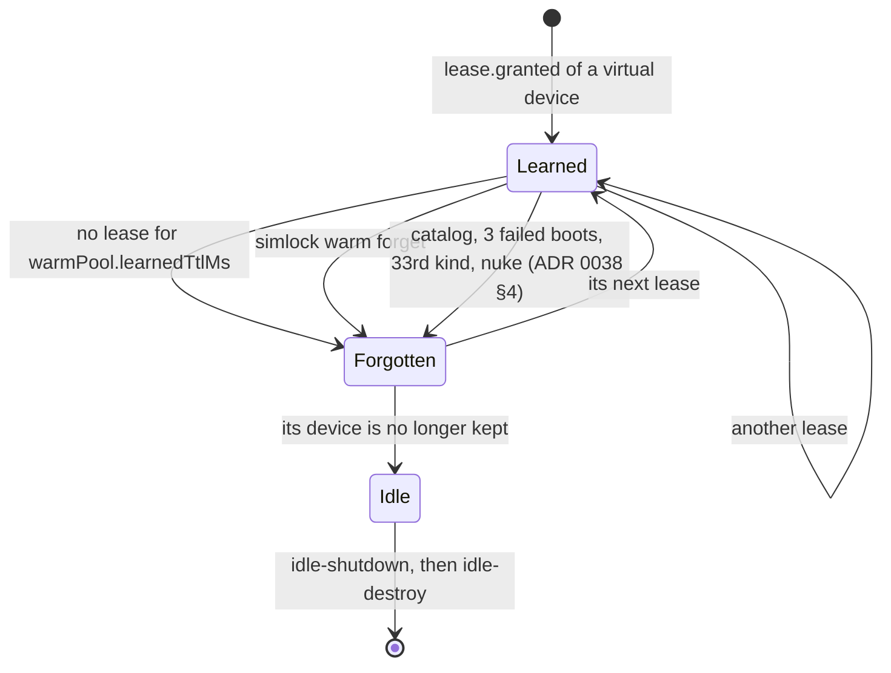

# 0050. A learned warm kind expires, and an operator can forget one

- **Status:** Proposed
- **Date:** 2026-10-28
- **Issue:** none; opened as a draft PR from a lab worker's report.
- **Narrows:** [ADR 0038](0038-the-warm-pool-learns-its-kinds-from-leases-and-boots-for-every-queued-request.md)
  §4 (when a kind is forgotten) gains two ways: no lease for
  `warmPool.learnedTtlMs`, and the operator's `warm.forget`. This reverses
  its rejected alternative "Forget a kind after a fixed time", with a
  default long enough that a kind used every week stays. §8's "No new
  config key" gains `warmPool.learnedTtlMs`. §5's "Lease rows that ended
  more than 24 hours ago are deleted on each write" keeps each kind's most
  recently ended row.

## Context

A lab Mac worker has two managed Android slots. A quoting mistake leased
`--device Pixel` (avdmanager's generic `pixel` profile) instead of
`Pixel 9`. Both leases were released. Since then the stray "Pixel"
emulator has stayed booted: `status` shows `managed 2/2, running 2`, and
`simlock cleanup --dry-run` proposes nothing.

That is ADR 0038 working as written. The kind `android/Pixel/36/full` is
learned; `targetedDevices()` keeps one ready device of every learned kind,
so `idle-shutdown` spares it and `idle-destroy` never sees it. A learned
kind is forgotten only when it leaves the catalog, after three failed
boots, when a 33rd kind arrives, or by `nuke`. A newer kind short for a
slot displaces it (§3), and leasing evicts it for another model, so
nothing is blocked; but the slot and its RAM are spent on a kind nobody
wants until then.

There is no supported way to undo one mistaken lease. `device remove` is
for physical devices only, no operation forgets one kind, and `nuke`
resets every lease and forgets every kind. The only workaround is to stop
the daemon and delete rows from `state.db` by hand.

## Decision

### 1. A learned kind no lease has used for `warmPool.learnedTtlMs` is forgotten

`warmPool.learnedTtlMs` is a positive integer, default 7 days
(604,800,000 ms). A kind is idle from the later of its last grant and its
last lease's end. A kind with a lease still held never expires. Each pass
forgets the kinds idle for at least the TTL, logging one `info` line per
kind; `targeted()` leaves them out from the moment they pass it, so the
reaper stops sparing their devices before the next pass. The idle rules
then shut the device down and delete it as for any idle device.

To keep a kind's last end past the 24 h window, the prune on each write
keeps each kind's most recently ended lease row. The peak count still
reads only the window, so the extra row changes no count.

The 24 h peak window, the 32-kind cap, `forget()` and nuke are unchanged.
A configured target never expires.

### 2. `warm.forget` forgets the kinds of one model

An admin operation, `warm.forget { platform, model, osVersion?, mode?,
imageTag? }`, forgets every learned kind of the model on the platform,
narrowed by each field given, and answers `{ forgotten: [...] }` with each
kind's platform, model, OS version, mode and image tag. It asks for a pass.
It does not act on a device: the device is no longer kept, so the
existing idle rules shut it down and delete it through
`ManagedDeviceLifecycle`. A configured target is untouched. A gateway
refuses it with `UNSUPPORTED_IN_GATEWAY_MODE`, like `nuke.run`. The CLI is
`simlock warm forget <platform> <model> [<os>] [--mode] [--image-tag]
[--json]`; the admin client is `forgetWarmKind`. The protocol version
rises by one.

## Consequences

- A stray kind's device is shut down and deleted on the reaper's next
  runs once `learnedTtlMs` has passed since its last lease, or once `warm
  forget` runs: both idle rules count from the lease's end, which by then
  is past `idle.shutdownAfterMs` and usually past `idle.deleteAfterMs`.
- A kind leased less than once a week now pays one cold boot on its next
  lease. An operator who wants ADR 0038's keep-forever can set a large
  `learnedTtlMs`.
- No device delete is added: an operator who wants one now runs `warm
  forget` and then `simlock cleanup`, or waits for the idle rules.
- No HTTP route or MCP tool: the CLI and the admin client cover the
  operator; an agent never needs it.

## Alternatives considered

- **Expire from the last grant only.** Rejected: a lease held for days
  would expire its kind the moment it ends.
- **A schema version with a `last_ended_at` column.** Rejected: an older
  Simlock refuses a `state.db` at a newer version, so a rollback would
  cost the whole file; keeping one ended row per kind needs no migration.
- **A virtual-device delete on `device remove`.** Deferred: the idle rules
  already delete an unkept device through the lifecycle, and a second
  delete path would need its own claim and revalidation.
- **Expire after 24 hours, the peak window.** Rejected: a kind used every
  working day but not at weekends would pay a cold boot each Monday.
